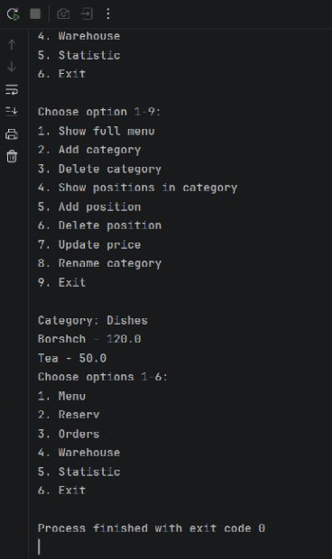
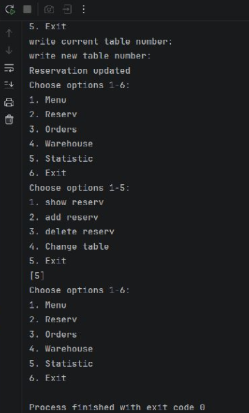
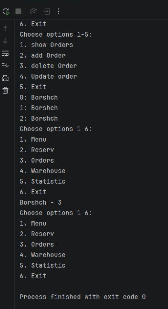
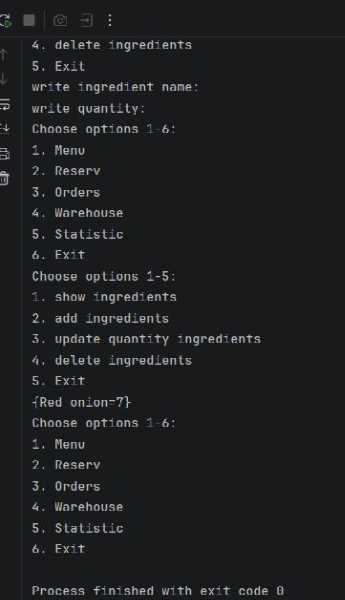
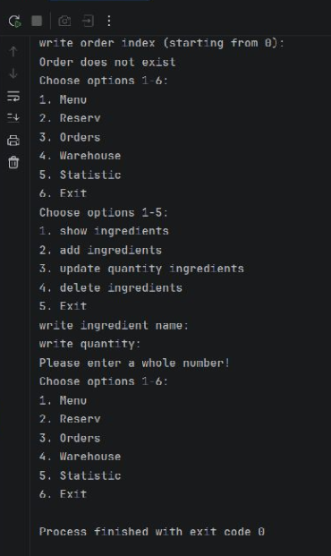

# Лабораторна робота №4 - варіант 2

Використано 
TreeMap, LinkedList, HashSet і HashMap.

Меню: додавання категорій і страв, перегляд, зміна ціни, перейменування та видалення.

Резервування: додавання, перегляд, зміна столика та видалення бронювання.

Замовлення: додавання страв із меню, перегляд, редагування та видалення. Статистика рахує кількість кожної страви в поточних замовленнях.

Склад: додавання інгредієнтів, перегляд, оновлення кількості та видалення.

Некоректні назви, числа, індекси та відсутні записи перевіряються, програма виводить повідомлення про помилку та продовжує роботу.

